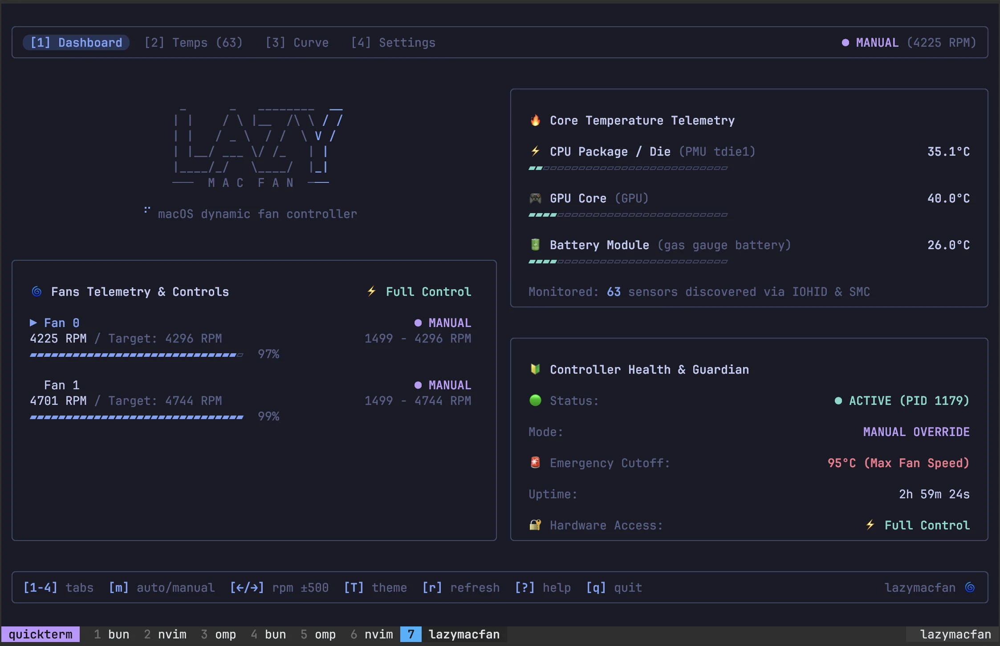

# lazymacfan 🌀

> Lightweight macOS TUI application and persistent background fan controller for Apple Silicon and Intel Macs.

[](https://www.typescriptlang.org/)
[](https://bun.sh)
[](https://biomejs.dev)
[](https://apple.com)

---

## 🖼️ Preview

<p align="center">
  
</p>

---

## 📖 Overview

**lazymacfan** is designed with a fundamental architectural principle:
> **The TUI is only the interface. Fan control continues independently in the background.**

When you exit the Terminal UI, the background controller keeps running, maintaining your manual RPM or applying your custom temperature curves.

```text
                 lazymacfan
                     │
          ┌──────────┴──────────┐
          │                     │
       OpenTUI                 CLI
          │                     │
          └──────────┬──────────┘
                     │
              Unix Domain Socket
                     │
                     ▼
             Background Agent
                     │
             ┌───────┴───────┐
             │               │
        Temperature     Fan Control
          Sensors         Backend
             │               │
             └───────┬───────┘
                     ▼
           macOS SMC & IOHID
```

---

## ✨ Features

- **Decoupled Architecture**: Terminal UI and background controller communicate via Unix domain socket (`lazymacfan.sock`). Exiting the UI does not stop fan management.
- **Universal Multi-Architecture**: Supports both **Apple Silicon** (M1/M2/M3/M4/M5) and **Mac Intel** (`x86_64`) via Universal Mach-O binaries.
- **Hardware Telemetry**: Reads all available temperature sensors (CPU, GPU, battery, memory, SSD) via `IOHIDEventSystemClient` and `AppleSMC`.
- **Automatic & Manual Modes**:
  - **Manual**: Set target RPM per fan.
  - **Automatic**: Customizable linear fan curves mapped to CPU/GPU package temperatures.
- **Hard Safety Guarantees**:
  - Hardware RPM clamping to minimum/maximum supported fan speeds.
  - Emergency 95°C override: forces 100% safe fan speed if critical temperatures are exceeded.
  - Fail-safe exit: returns fan control to macOS automatic hardware management on daemon shutdown.
- **Persistent Configuration**: Saved in `~/.config/lazymacfan/config.toml`.
- **macOS launchd Integration**: Start at login, run as daemon, restart on crashes.
- **Biome Toolchain**: Linting and formatting with `biome`, git hooks with `lefthook`, and testing with `vitest`.
- **Reproducible Dev Environment**: Preconfigured with `flake.nix` and `direnv`.

---

## 🚀 Installation

### Homebrew (Recommended)

```bash
brew tap zeetec20/lazymacfan
brew install lazymacfan
```

Or in one command:
```bash
brew install zeetec20/lazymacfan/lazymacfan
```

To run as a persistent background service with `launchd`:
```bash
brew services start lazymacfan
```

> Homebrew installs manage the agent with `brew services`. Don't also run
> `lazymacfan service start` — it installs a second launchd job and both fight
> over fan control.

### Nix (flake)

```bash
# Run it without installing
nix run github:zeetec20/lazymacfan

# Install it into your profile
nix profile install github:zeetec20/lazymacfan
```

Or as an input in another flake:

```nix
inputs.lazymacfan.url = "github:zeetec20/lazymacfan";
# use: inputs.lazymacfan.packages.${system}.default
```

The flake installs the same prebuilt release binaries as Homebrew, for both
`aarch64-darwin` (Apple Silicon) and `x86_64-darwin` (Intel) — no `bun` or Xcode
required.

Upgrade and remove:

```bash
nix profile upgrade lazymacfan   # or: nix profile upgrade --all
nix profile remove lazymacfan
```

Nix has no service manager for lazymacfan, so start the agent with the built-in
launchd integration instead of `brew services`:

```bash
lazymacfan service start
```

The launchd job it writes points at the `/nix/store` path of the installed
version, so re-run `lazymacfan service restart` after upgrading.

### From Source (Bun + Nix)

```bash
git clone https://github.com/zeetec20/lazymacfan.git
cd lazymacfan

# Enter the dev shell (bun + clang):
nix develop          # or: direnv allow

# Install dependencies:
bun install

# Build universal binaries:
bun run build        # -> dist/lazymacfan, dist/lazymacfan-helper
```

The dev shell works on both architectures. On Intel, nixpkgs has no cached
`bun` build, so the first `nix develop` builds it locally from bun's upstream
release tarball.

---

## 🎮 Usage

### 1. Interactive Terminal UI (OpenTUI)

```bash
lazymacfan
```

#### Keybindings
| Key | Action |
|---|---|
| `d` | Go to Dashboard |
| `f` | Go to Fans view & manual control |
| `t` | Go to Temperature Sensors view |
| `c` | Go to Fan Curve visualization |
| `s` | Go to Settings view |
| `m` | Toggle between Manual and Automatic fan mode |
| `←` / `→` | Decrease / Increase target fan speed (±100 RPM) |
| `↑` / `↓` | Navigate list items |
| `r` | Refresh hardware telemetry |
| `?` | Toggle Help modal |
| `q` | Quit UI (agent continues running in background) |

---

### 2. Command Line Interface (CLI)

```bash
# Start background controller daemon directly
lazymacfan agent

# Check controller status & telemetry
lazymacfan status

# List all detected fans
lazymacfan fans

# List all temperature sensors
lazymacfan sensors

# Set fan speed manually
lazymacfan fan 0 --rpm 3200

# Toggle mode
lazymacfan mode auto
lazymacfan mode manual

# Service management (launchd)
lazymacfan service start
lazymacfan service stop
lazymacfan service restart
lazymacfan service status

# View background logs
lazymacfan logs
lazymacfan logs --follow

# Helper privileges (setuid root for AppleSMC writes)
lazymacfan helper status
sudo lazymacfan helper setup

# Launch the TUI in read-only monitor mode (no fan control, no privileges)
lazymacfan --read-only

# Check for or install updates (no-op when managed by Homebrew or Nix)
lazymacfan update --check

# Uninstall the launchd job, the privileged helper, and this binary
lazymacfan uninstall
```

---

## ⚙️ Configuration (`config.toml`)

Stored at `~/.config/lazymacfan/config.toml` (or
`$XDG_CONFIG_HOME/lazymacfan/config.toml` when `XDG_CONFIG_HOME` is set). A config
left at the old `~/Library/Application Support/lazymacfan/config.toml` path is
migrated to the new location on first read.

```toml
[controller]
mode = "auto"
poll_interval_ms = 1000
emergency_temp_c = 95
temp_unit = "C"

[fan.0]
target_rpm = 2500

[fan.0.automatic]
sensor = "auto"

[[fan.0.automatic.curve]]
temperature = 45
rpm = 1800

[[fan.0.automatic.curve]]
temperature = 60
rpm = 3000

[[fan.0.automatic.curve]]
temperature = 75
rpm = 4500
```

---

## 🛠️ Development & Quality Assurance

This project uses **Biome** for linting and formatting and **lefthook** for git hooks, alongside
**Bun** and **TypeScript**:

```bash
# Lint with Biome
bun run lint
bun run lint:fix

# Format with Biome
bun run format
bun run format:check

# Install the git hooks (also runs on `bun install`)
bunx lefthook install

# Run unit and integration tests (Vitest / Bun)
bun run test
bun run test:bun

# Type check (strict TypeScript)
bun run typecheck

# Build Universal Mach-O Binaries (arm64 + x86_64)
bun run build
```

The `pre-commit` hook runs `bun run lint:fix` on staged files via `lefthook`, so Biome's fixes are
applied and re-staged before the commit lands.

---

## 🔒 Safety & Permissions Notice

- **Telemetry (Read-Only)**: Querying fan speeds and temperature sensors requires no special permissions and works out-of-the-box for any user.
- **Fan Speed Control (Write)**: On macOS, writing to the System Management Controller (`AppleSMC`) registers fundamentally requires administrative privileges (`root` / `sudo`).
- **One-Command Helper Authorization (Recommended)**: To allow foreground TUI sessions and background agents to adjust fan speeds without needing `sudo` or password prompts every time, authorize the native helper once:
  ```bash
  sudo lazymacfan helper setup
  ```
  This applies `chmod 4755` (setuid root) to `lazymacfan-helper`. You can check the current status anytime:
  ```bash
  lazymacfan helper status
  ```

---

## ❓ Troubleshooting

### "Failed to set fan speed" or "Permission denied (kIOReturnNotPrivileged)"
- **Cause**: The kernel `AppleSMC` driver rejected write commands because the process lacks root privileges (`euid != 0`).
- **Fix**: Authorize the native helper binary with:
  ```bash
  sudo lazymacfan helper setup
  ```
  Or start the background controller daemon with sudo:
  ```bash
  sudo lazymacfan agent
  ```

---

## 📄 License

MIT License.
